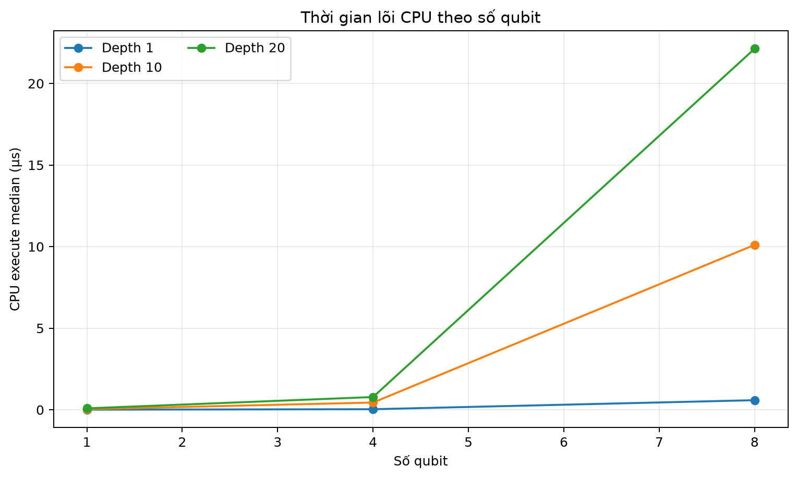
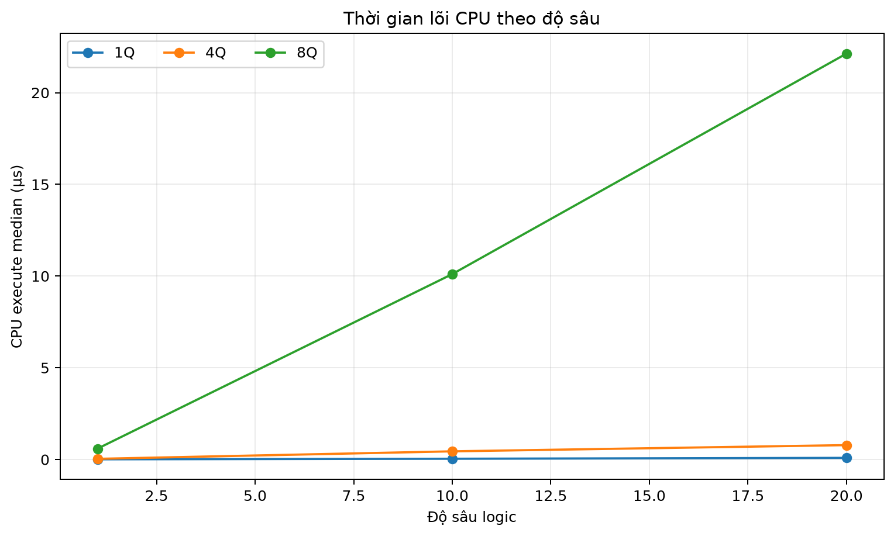
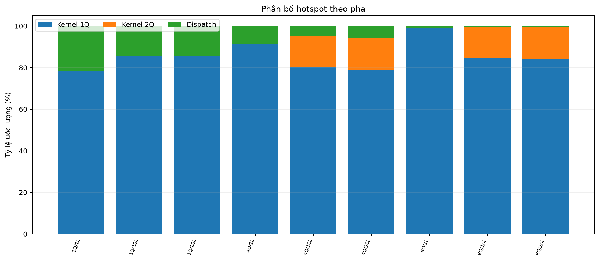
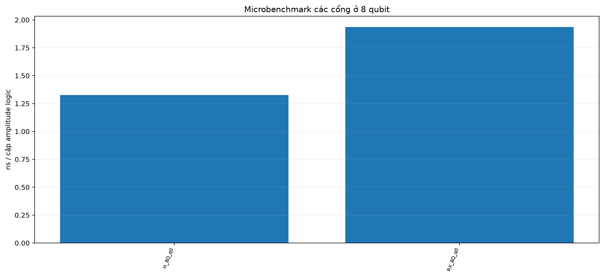
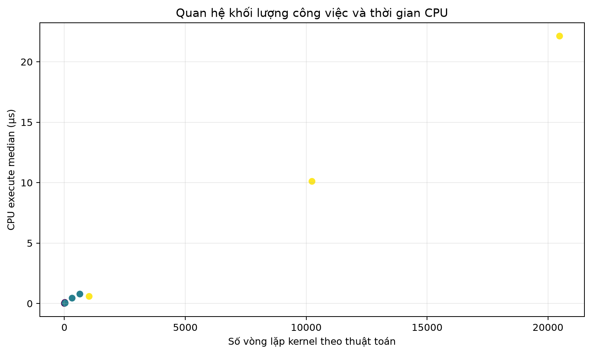

# Báo cáo profiling CPU QSim8Q

## Phạm vi và phương pháp

Đây là lần chạy nhanh để kiểm tra công cụ; chưa dùng các số liệu này làm kết quả chính thức.

- Lõi được đo: state-vector C++ FP32, một luồng, biên dịch Release `-O3`.
- Qiskit chỉ sinh mạch đã transpile và state-vector chuẩn trước khi đo.
- UART, web, ghi CSV và Qiskit/Aer không nằm trong vùng thời gian.
- Mỗi phép đo dùng batch tự hiệu chỉnh tối thiểu 2.0 ms, 5 mẫu và 1 warm-up.
- Tiến trình được ghim vào CPU logic 4 để tránh di chuyển giữa lõi P/E.
- `kernel_1q`, `kernel_2q` và `dispatch` được đo tách biệt; tỷ lệ hotspot là tỷ lệ ước lượng từ ba phép đo này.
- `reset` và `copy` là chi phí biên được báo riêng, không cộng vào `execute`.

## Môi trường

- CPU: 13th Gen Intel(R) Core(TM) i5-13400F
- Hệ điều hành: Windows-11-10.0.26200-SP0
- Compiler: g++.exe (Rev5, Built by MSYS2 project) 16.1.0
- Số CPU logic: 16
- UTC: 2026-10-01T15:39:42.404952+00:00

## Kiểm tra tính đúng

- Kết quả FP32 đạt so với state-vector Qiskit: **15/15** ca.
- Ngưỡng kiểm tra: `max_error ≤ 1e-5`, `fidelity ≥ 1 - 1e-7`, `norm_error ≤ 1e-5`.
- So sánh đã loại global phase trước khi tính sai số cực đại.

## Chất lượng số đo

- Robust CV lớn nhất trong 40 ca scaling: **3.33%** tại `MIXED_8Q_10L`.
- Số ca scaling có robust CV lớn hơn 10%: **0/40**.
- CV thường lớn nhất là **6.56%** tại `MIXED_8Q_10L`; giá trị này nhạy với ngắt hệ điều hành và vẫn được giữ trong CSV.
- Báo cáo dùng median làm giá trị trung tâm, robust CV đánh giá độ ổn định và p95 thể hiện nhiễu lập lịch.

## Benchmark mở rộng

| Ca | Qubit | Depth | Lệnh | Median µs | P95 µs | Robust CV % | Miter/s | Qiskit |
| --- | ---: | ---: | ---: | ---: | ---: | ---: | ---: | --- |
| MIXED_1Q_1L | 1 | 1 | 1 | 0.0094 | 0.0094 | 0.27 | 106.35 | PASS |
| MIXED_1Q_10L | 1 | 10 | 10 | 0.0405 | 0.0431 | 0.85 | 246.69 | PASS |
| MIXED_1Q_20L | 1 | 20 | 20 | 0.0876 | 0.0883 | 1.58 | 228.36 | PASS |
| MIXED_4Q_1L | 4 | 1 | 4 | 0.0357 | 0.0365 | 1.28 | 897.54 | PASS |
| MIXED_4Q_10L | 4 | 10 | 34 | 0.4439 | 0.4494 | 1.18 | 720.83 | PASS |
| MIXED_4Q_20L | 4 | 20 | 68 | 0.7827 | 0.7910 | 1.18 | 817.66 | PASS |
| MIXED_8Q_1L | 8 | 1 | 8 | 0.5889 | 0.6089 | 2.54 | 1738.85 | PASS |
| MIXED_8Q_10L | 8 | 10 | 66 | 10.1075 | 11.2826 | 3.33 | 1013.11 | PASS |
| MIXED_8Q_20L | 8 | 20 | 132 | 22.1300 | 22.2024 | 0.17 | 925.44 | PASS |

## Hotspot

Ở ca `MIXED_8Q_20L`, tỷ lệ ước lượng là:

| Pha | Tỷ lệ |
|---|---:|
| Kernel 1Q | 84.41% |
| Kernel 2Q | 15.15% |
| Dispatch | 0.44% |

Pha lớn nhất trong ca này là **kernel 1Q**. Hệ số tương quan Pearson giữa số vòng lặp kernel theo thuật toán và thời gian `execute` của ma trận scaling là **0.998956**. Kết luận này chỉ áp dụng cho cấu hình CPU và phạm vi 1–8 qubit của lần đo.

Các vùng mã tương ứng là `apply_single_qubit_gate`, `apply_two_qubit_gate` và
`execute_circuit` trong `cpu_profile/qsim_cpu.cpp`. Mỗi cổng 1Q duyệt
`2^(n-1)` cặp amplitude; mã CPU 2Q hiện duyệt `2^n` chỉ số và cập nhật tập con
thỏa bit control/target. Đây là các vòng lặp cần đối chiếu với pipeline và tổ
chức BRAM của HLS V1–V6.

## Microbenchmark

| Ca vi mô | Lệnh | Median µs | Robust CV % | Qiskit |
| --- | ---: | ---: | ---: | --- |
| MICRO_H_1Q_q0 | 1 | 0.0045 | 0.17 | PASS |
| MICRO_RX_1Q_q0 | 1 | 0.0050 | 0.90 | PASS |
| MICRO_H_4Q_q0 | 1 | 0.0118 | 0.09 | PASS |
| MICRO_RX_4Q_q0 | 1 | 0.0179 | 1.29 | PASS |
| MICRO_H_8Q_q0 | 1 | 0.1698 | 0.13 | PASS |
| MICRO_RX_8Q_q0 | 1 | 0.2479 | 0.35 | PASS |

## Biểu đồ

## Diễn giải cho thuyết minh

Số vòng lặp cập nhật state-vector tăng theo số lệnh và theo số amplitude. Số liệu `kernel_1q`, `kernel_2q` và `dispatch` cho biết phần nào chiếm thời gian thay vì suy luận từ mã nguồn. Đây là căn cứ nối công việc profiling CPU với các thử nghiệm PIPELINE, BRAM, dữ liệu đóng gói và Q2.30 trong HLS V1–V6.

State-vector 8 qubit FP32 chỉ có 256 số phức, khoảng 2 KiB, thường nằm trong cache L1. Kết quả không được diễn giải thành bằng chứng nghẽn DRAM ở quy mô lớn. Trên FPGA, giới hạn truy cập BRAM/II là vấn đề kiến trúc riêng được chứng minh bằng báo cáo HLS.

## Tệp dữ liệu

- `cpu_profile_raw.csv`: từng mẫu và batch repetitions.
- `cpu_profile_summary.csv`: median, p95, CV, phân bố pha và độ chính xác.
- `validation.csv`: đối chiếu FP32 với Qiskit.
- `manifest.json`: môi trường, cấu hình, lệnh biên dịch và hash mã nguồn.
- `suite.tsv`: mạch native và state-vector Qiskit đã dùng.
